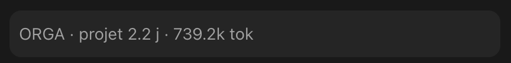

# temps-projet

Affiche au-dessus du champ de saisie le temps passé sur le projet courant,
converti en journées de travail, et les tokens de la conversation :



Une ligne, en gris, recalculée à l'ouverture de la session et à la fin de chaque
tour du modèle. Rien d'autre ne change dans l'interface. La capture est en thème
sombre ; le bandeau prend la couleur atténuée du thème en cours, clair compris.

## Ce que le temps veut dire

Le temps compte comme la somme des intervalles entre deux messages inférieurs au
seuil d'inactivité. Au-delà du seuil, on considère que vous étiez parti : le
compteur reprend à votre message de retour. C'est le seul temps que Claude Code
puisse connaître — `cost.total_duration_ms`, qu'il expose, mesure le temps
calendaire depuis l'ouverture de la session, nuits comprises.

**Ce n'est donc pas du temps facturable.** Tout le travail hors de la
conversation compte pour zéro. Le chiffre est un plancher.

## Les trois fichiers qu'il écrit

Claude Code efface ses transcripts au bout de trente jours, et c'est d'eux que
le temps est tiré. Le mod garde donc ce qu'il a lu, dans le dossier de
configuration de Claude Code (`~/.claude`, ou ce que nomme `CLAUDE_CONFIG_DIR`) :

- `statusline-temps-cache.json` — un offset et un cumul par session. C'est ce
  qui fait que la lecture est incrémentale : on ne relit jamais ce qu'on a déjà
  lu, et un transcript qui disparaît ne fait rien perdre.
- `temps-projets.md` — le relevé lisible, par projet : total, temps mesuré,
  nombre de sessions, période. Réécrit au plus une fois par jour, et
  **seulement entre ses deux marqueurs** `<!-- compteur: debut -->` et
  `<!-- compteur: fin -->` : ce que vous écrivez autour est préservé.
- `temps-projets-journal.tsv` — le cumul du jour par projet, ajouté seulement
  quand il a bougé. Le relevé dit où on en est, le journal dit ce qui a changé
  depuis la dernière fois.

## Les journées hors Claude

`temps-manuel.tsv`, dans le même dossier, est à vous : une ligne par journée
déclarée, `date⇥projet⇥heures⇥note`, les lignes commençant par `#` ignorées.

```
2026-10-14	Atelier	6	essais sur le terrain
```

Ces heures s'ajoutent au total du projet mais restent dans leur propre colonne :
une mesure et une déclaration ne se confondent pas. Le nom du projet est celui
qui s'affiche, donc celui de la table des groupes si le projet y figure.

## Réglages

Quatre, dans `/config` ou dans `pluginConfigs` de vos settings :

- **Durée d'une journée** — en heures, 8 par défaut. C'est l'unité d'affichage :
  le compteur mesure des heures, il les montre en journées.
- **Seuil d'inactivité** — en minutes, 15 par défaut. Le changer ne réécrit pas
  le passé : il s'applique à ce qui reste à lire. Pour tout recompter avec le
  nouveau seuil, supprimez le cache et relancez l'amorçage — ce qui perd les
  transcripts déjà effacés.
- **Langue** — `fr` ou `en`, pour la ligne affichée et pour le relevé.
- **Projets groupés** — voir ci-dessous.

## Projets groupés

Une conversation vaut un projet dans la quasi-totalité des cas, et un projet
absent de la table s'affiche avec son chemin : c'est seulement un nom moins
joli, rien ne se perd. La table sert aux deux cas où ça ne suffit pas : un
projet **renommé**, qui repartirait de zéro sur une deuxième ligne, et deux
conversations ouvertes sur **le même travail**.

Des paires `dossier=Nom` séparées par des points-virgules, où le dossier est le
nom que Claude Code donne au dossier de transcripts du projet — son chemin
aplati, les séparateurs et les accents devenus des tirets :

```
-Users-moi-Documents-Chose=Chose; -Users-moi-Documents-Vieux-Nom=Chose
```

Le nom exact se lit dans `~/.claude/projects` :

```
ls ~/.claude/projects
```

Un objet JSON est accepté aussi, si vous préférez.

Après avoir changé la table, relancez l'amorçage pour que les sessions déjà en
cache reprennent leur nom :

```
python3 ~/.claude/plugins/.../temps-projet/scripts/compteur.py --amorcer
```

Il relit tous les projets et réécrit le relevé. Il **fusionne** : une session
dont le transcript a disparu garde le temps déjà compté, elle n'est jamais
effacée. `claude plugin list` dit d'où le mod est lu, donc où est le script.

## Dans un terminal, sans le mod

Le réglage `statusLine` de `settings.json` fait la même chose dans le CLI en
terminal, et le même script le sert : l'état arrive sur stdin au lieu de l'id de
session. C'est d'ailleurs la raison d'être du mod — l'app desktop n'exécute pas
`statusLine`.

```json
"statusLine": { "type": "command",
  "command": "/usr/bin/python3 <chemin du mod>/scripts/compteur.py" }
```

Les réglages sont alors relus directement dans `pluginConfigs`, donc les deux
chemins comptent pareil.

## Ce qu'il lui faut

Python 3, déjà présent sur macOS et sur toute distribution Linux courante. Le
mod cherche `/usr/bin/python3`, puis Homebrew, puis `python3` dans le PATH.
Aucune dépendance, aucun accès au réseau, rien qui sorte de votre machine.

## Installation

À l'invite d'une session en terminal :

```
/plugin install temps-projet --marketplace zerpo-lab/temps-projet
```

Dans l'app desktop, où `/plugin` ne s'exécute pas : le `+` à côté du champ de
saisie, puis Plugins, Add marketplace, puis Add plugin. Depuis un dossier local,
`claude plugin install temps-projet --marketplace <chemin du dossier>` suffit, et
le mod reste alors relu depuis ce dossier à chaque `/reload-plugins`.
